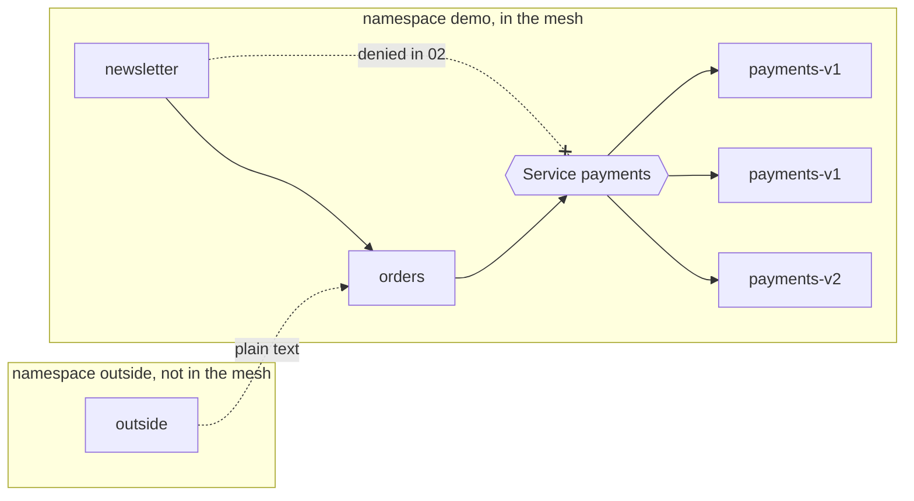
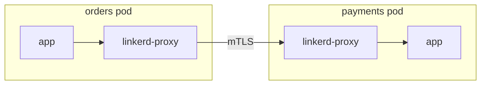
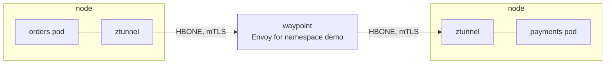
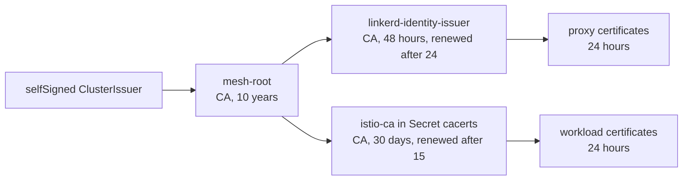

# service-mesh-lab

Linkerd and Istio in ambient mode on a local kind cluster, and seven things a
mesh is usually brought in for, each one checked by a script that sends real
requests and fails if the mesh does not do what it should.

Both meshes run the same workloads and the same checks. Only the mesh layer
differs, and in every scenario the Linkerd and the Istio manifests sit next
to each other, so comparing them shows exactly what each mesh asks for.

```sh
make up MESH=linkerd         # kind, cert-manager, the mesh, its metrics, the workloads
make test MESH=linkerd       # every scenario, or S=03-canary for one
make stats MESH=linkerd      # success rate, RPS, latency and mTLS per workload
make dashboard MESH=linkerd  # Linkerd viz, or Kiali for Istio
make down MESH=linkerd
```

The same with `MESH=istio`. Each mesh gets a cluster of its own,
`mesh-linkerd` or `mesh-istio`, so both can run at once.

Needs Docker, kind, kubectl and helm. `make stats` and `make dashboard` also
need the `linkerd` CLI, or `istioctl` and jq. A cluster takes about 3 GB of
memory and `make up` about five minutes on a cold cache.

## What runs



A small shop. Placing an order charges a payment, so `orders` calls
`payments`, and nothing else should. `newsletter` is a marketing service in
the same namespace with an identity of its own: it may call `orders`, but has
no business with `payments`, and is the caller the authorization scenario
keeps out. `outside` lives in a namespace that is not part of the mesh, and
stands for anything that talks to it without an identity at all.

Each workload has its own service account, and that is its identity in the
mesh. `payments-v1` has two replicas so that one of them can break while the
other keeps serving. Every box is
[podinfo](https://github.com/stefanprodan/podinfo), so the application is
never the interesting part: `orders` calls `payments` on each `POST /echo`.

## Where the mesh sits

Linkerd puts a proxy into every pod:



The proxy on the caller's side picks the destination, applies routes,
timeouts and retries; the one on the receiving side enforces policy. Both
read HTTP.

Istio in ambient mode keeps the pods as they are:



ztunnel on each node encrypts and authenticates every connection but does not
read HTTP. The waypoint is the one place in the namespace that does, and so
the place where routes, retries, timeouts and HTTP authorization happen.

## Scenarios

| | Scenario | Checked | Linkerd | Istio |
| --- | --- | --- | --- | --- |
| 01 | [mTLS](scenarios/01-mtls) | plain text from `outside` is refused, meshed calls still work | `Server` for the whole namespace, `accessPolicy: all-authenticated` | `PeerAuthentication` STRICT for the namespace |
| 02 | [Authorization](scenarios/02-authorization) | only `orders` reaches `payments`: via either Service or a pod IP, `newsletter` and `outside` are denied | `Server`, `AuthorizationPolicy`, `MeshTLSAuthentication` | two `AuthorizationPolicy`: on the Services at the waypoint, on the pods at ztunnel |
| 03 | [Canary](scenarios/03-canary) | 300 requests to `payments`, about 10% answered by v2 | Gateway API `HTTPRoute` with weights | the same file |
| 04 | [Header routing](scenarios/04-header-routing) | `x-canary: true` always reaches v2, nothing else does | `HTTPRoute` with a header match | the same file |
| 05 | [Timeouts](scenarios/05-timeouts) | a two second request is cut off with 504 after one | `HTTPRoute` `timeouts.request` | the same file |
| 06 | [Retries](scenarios/06-retries) | one broken replica: a third to a half of requests fail without retries, none with | `retry.linkerd.io` annotations on the route | `HTTPRoute` `retry`, experimental channel |
| 07 | [Circuit breaking](scenarios/07-circuit-breaking) | the broken replica is taken out of rotation after three failures | failure accrual annotations on the Service | `DestinationRule` outlier detection |

A scenario applies its manifests, waits for the mesh to pick them up, checks,
and deletes them again, so they can run in any order. Manifests at the top of
a scenario are read by both meshes as they are; the rest sits in its
`linkerd/` or `istio/` directory. The checks run `curl` inside the pods with
`kubectl exec`, which means the requests leave the pod like the
application's own would and carry its identity.

```
$ make test MESH=linkerd S=06-retries
06-retries
  ok    the route sends payments to v1 only
        payments-v1 without retries: 54 of 100 failed
  ok    the broken replica fails requests when nothing retries
        payments with retries:       0 of 100 failed
  ok    retries hide the broken replica
```

Scenarios 03, 04 and 05 need no mesh specific file at all. Linkerd and Istio
both implement Gateway API for traffic inside the mesh (the GAMMA
initiative), where the parent of a route is a Service and not a Gateway.
Retries and circuit breaking are where the standard ends and each mesh has
its own way.

## Authorization in ambient mode

Scenario 02 is the one where ambient mode needs more thought than a sidecar
mesh. The obvious policy, attached to the `payments` Services and allowing
only `orders`, is enforced by the waypoint. But `newsletter` connecting to a
pod IP does not go through any Service, so it never meets the waypoint. With
only that policy in place:

```
newsletter -> http://payments:9898/      403
newsletter -> http://10.244.1.7:9898/    200
```

The second policy closes it at ztunnel, in front of the payments pods: the
only identity allowed to connect there is the waypoint's own. Together they
give what a Linkerd `Server` policy gives in one object, because a sidecar
sees every connection to its pod however it was addressed.

## Identity

Both meshes sign a certificate for every workload with an intermediate CA.
Here neither intermediate is generated by the mesh: cert-manager issues both
from one root, `mesh-root`.



Linkerd's identity controller and istiod both watch their Secret and pick up
a renewed intermediate without a restart. Linkerd's trust anchor is read from
the `mesh-root` Secret at install time rather than committed, and `linkerd
check` warns that the issuer is valid for less than 60 days, which is the
point of a 48 hour issuer. cert-manager writes Istio's `cacerts` in the
`kubernetes.io/tls` layout, which istiod reads directly.

The root itself is self-signed only because this is a laptop. In a real
cluster it would sit in Vault or an offline CA and cert-manager would only
see the intermediates; nothing downstream of `mesh-root` would change.

## Linkerd and Istio side by side

| | Linkerd | Istio, ambient mode |
| --- | --- | --- |
| Data plane | a Rust micro proxy as a sidecar in every pod | ztunnel per node for L4 and mTLS, an Envoy waypoint per namespace for HTTP |
| Joining the mesh | annotation on the namespace, pods restart to get the sidecar | label on the namespace, pods are not touched |
| Traffic redirection | Linkerd CNI plugin | Istio CNI node agent |
| mTLS | on between meshed pods, plain text accepted until a policy says otherwise | the same, until `PeerAuthentication` STRICT |
| Authorization | on the pod's port: `Server` and `AuthorizationPolicy` | on the Service at the waypoint, plus a ztunnel rule for direct pod traffic |
| Routing, timeouts | Gateway API `HTTPRoute` | the same files |
| Retries | annotations on the `HTTPRoute` | `retry` field of `HTTPRoute`, experimental channel |
| Circuit breaking | failure accrual annotations on the Service | `DestinationRule` outlier detection |
| Metrics | viz: its own Prometheus, CLI and dashboard | Prometheus and Kiali addons |
| Releases | open source edge releases only, stable builds come from Buoyant | open source stable releases |

## Choices

**Istio in ambient mode, not with sidecars.** Sidecar mode would make the
two meshes look more alike, and that is the reason not to use it here: it
would mostly repeat the Linkerd setup with a heavier proxy. Ambient is where
Istio is going, and it moves real decisions (where HTTP policy is enforced,
what a pod IP bypasses) that are worth showing.

**One waypoint for the namespace.** `istio.io/use-waypoint` on the namespace
sends every Service in it through the same waypoint. Per Service waypoints
are possible and isolate noisy services from each other, but for four
workloads they would only add Deployments.

**Linkerd edge releases.** Since 2024 the Linkerd project publishes only
edge releases as open source; stable releases are Buoyant's. The chart
version is pinned in `linkerd/mesh.mk` and moves forward deliberately.

**Istio 1.30.** 1.31 is out, but its Helm charts were not published yet when
this was set up. The charts and `istioctl` move together.

**CNI for both.** Without Linkerd's CNI plugin, every meshed pod gets an init
container that needs `NET_ADMIN` and runs as root, which breaks
`runAsNonRoot` on the pod. Ambient has its CNI node agent anyway. Either way,
the workloads keep the same security context they would have without a mesh.
Linkerd's plugin runs with its repair controller, which recreates pods that
started on a node before the plugin was ready there.

**Gateway API CRDs from upstream.** Mesh charts can install them, but then
their version follows the mesh. Installing them separately keeps them under
the cluster's control and the same release for both. Linkerd gets the
standard channel; Istio the experimental one, only for the `retry` field in
scenario 06.

**Exec'd curl instead of a load testing tool.** Every check is a few lines of
shell over `curl` output, so a failure is readable without knowing a tool.

## Layout

```
apps/          the workloads, the same for both meshes
identity/      the root CA both meshes chain up to
linkerd/       Linkerd: install, values, its issuer, how the namespace joins
istio/         Istio: install, values, its CA, the namespace and its waypoint, the stats query
scenarios/     one directory each: check.sh, shared manifests, linkerd/ and istio/
scripts/       the scenario runner and its helpers
```

Everything one mesh needs and the other does not lives in a directory named
after it, so `find . -path '*linkerd*'` or `-path '*istio*'` lists all of it.
